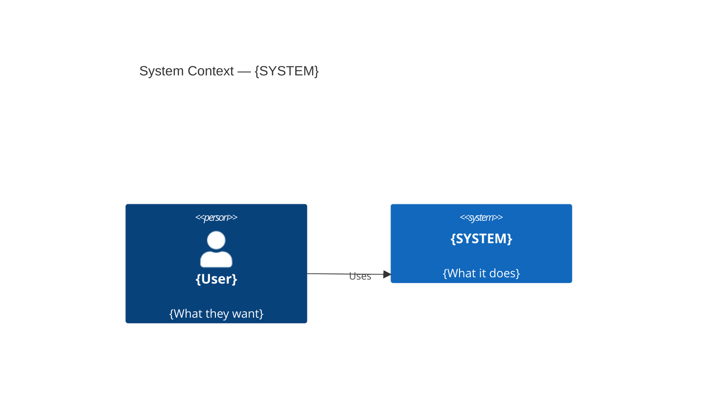
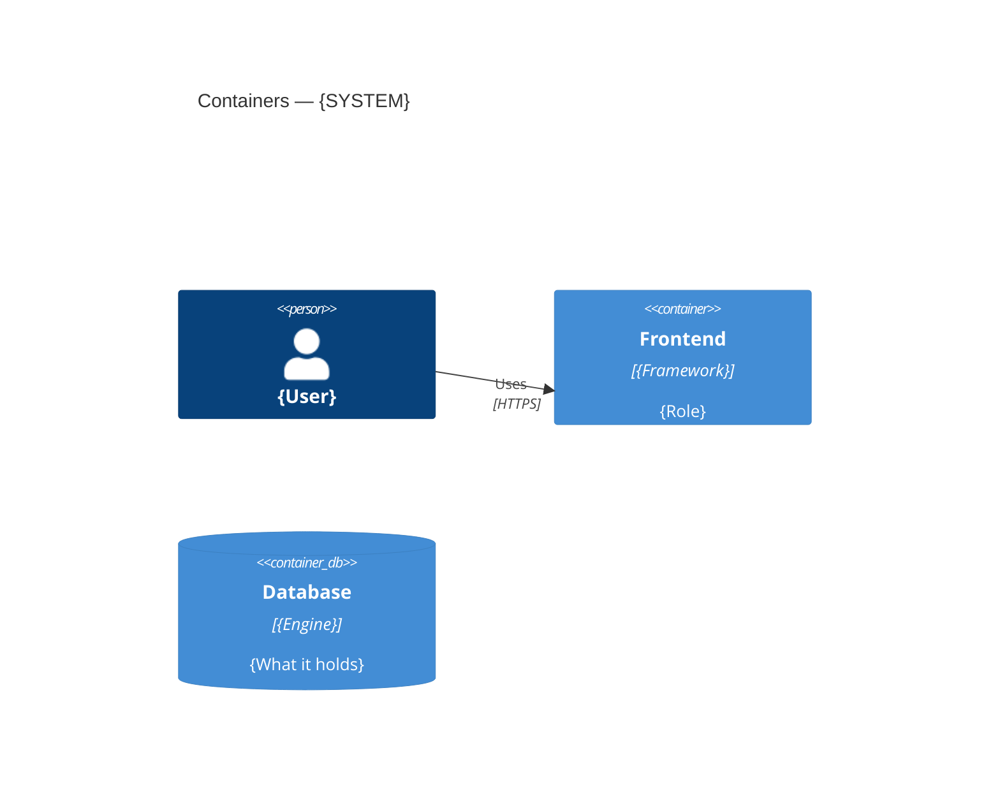

# 1-N-CQDS Doctrine Engine — Implementation Plan (Plan 1 of 3)

> **For agentic workers:** REQUIRED SUB-SKILL: Use superpowers:subagent-driven-development (recommended) or superpowers:executing-plans to implement this plan task-by-task. Steps use checkbox (`- [ ]`) syntax for tracking.

**Goal:** Build the installable `1-n-cqds` plugin skeleton plus the three skills that constitute the doctrine engine — router, `defining-purpose`, `deciding-architecture` — such that running it against a real project idea produces a defensible `ARCHITECTURE.md` and ADR set.

**Architecture:** A Claude Code plugin. A router skill owns four invariants and dispatches to phase skills. `deciding-architecture` runs a nine-step decision sequence whose every step emits an ADR, including rejections. Decision state lives in committed markdown (`ARCHITECTURE.md` + `docs/adr/`), which is what makes governor mode possible later.

**Tech Stack:** Markdown skills with YAML frontmatter; `.claude-plugin/plugin.json` manifest; Python 3 for the scaffold script (Plan 2); `git` for decision-state persistence.

## Why this is Plan 1 of 3

The spec (`docs/superpowers/specs/2026-07-17-1-n-cqds-design.md`) covers three separable subsystems. Per the writing-plans scope check, each gets its own plan, and each produces working, testable software alone:

| Plan | Contents | Standalone value |
|---|---|---|
| **1 (this)** | plugin skeleton, router, `defining-purpose`, `deciding-architecture`, ADR/ARCHITECTURE output | Run it on a project idea → get decisions + ADRs. Usable with zero templates. |
| **2** | `scaffolding-repository`, `building-frontend`, `adding-backend-service` + all assets | Turns decisions into a real repo. |
| **3** | `wiring-delivery`, `managing-releases` + CI assets | Adds pipelines and release engineering. |

**Plan 1 first is deliberate.** The doctrine engine is the part that can be *wrong*. Templates are mechanical once the decisions they encode are trustworthy. Validating the gates against a real project idea before writing a single Dockerfile is the whole point of the sequencing.

## Reframe: reference-and-record, not discipline (added 2026-07-18)

**Approved by Greg after three consecutive green discipline baselines** (statelessness Task 2, purpose-on-substance Task 4, cache/queue Task 6 at 6/6).

The original plan framed each gate as a *discipline* test — baseline the model failing, then armor against the rationalizations. The evidence says capable models **do not fail these disciplines**: they already keep services stateless, already refuse Redis under a non-negotiable CTO, already decline queues without a named pattern. The RED baselines keep coming back green.

What the models lack is not discipline but three things this methodology supplies:

1. **Artifacts** — `docs/purpose.md`, ADRs (including *rejection* ADRs), `ARCHITECTURE.md`. Models reason correctly but do not produce durable records unprompted. Task 4 proved this precisely: green on the judgment, red on the artifact.
2. **Words** — the vocabulary and standing to justify a correct instinct to a stakeholder overruling it ("authority is not evidence — name the pattern").
3. **Consistency** — the good instinct firing *every time*, on the record, rather than most of the time.

**Consequences for the remaining tasks:**

- Still run each baseline — a green result is a *finding*, not a skip. But **expect green**, and do not pre-write rationalization tables or red flags. Armor exists only for rationalizations actually observed (the house rule, now reinforced).
- **Grade on the artifact, not the resistance.** Task 7's pass condition is "the language ADR is written and records the rejected alternatives," not "the agent resisted the VP." Task 9 grades the produced ADR/ARCHITECTURE set, not pressure-resistance.
- A gate's skill is a **reference** an agent cites, plus a **record** it emits — not a cage.

**Rulings that add doctrine go into the spec first, then flow to skills.** Task 6's two findings both came from rulings that landed in a dispatch prompt and a skill without passing through the spec, so they read as invented. Fixed by promoting both to the spec's cache/queue section. This is now the rule: no doctrine enters a skill that isn't in the spec.

## The Iron Law governs this plan

**REQUIRED BACKGROUND:** You MUST read superpowers:writing-skills and its `testing-skills-with-subagents.md` before Task 2.

**NO SKILL WITHOUT A FAILING TEST FIRST.** Every skill task follows RED → GREEN → REFACTOR:

- **RED** — dispatch a subagent with a pressure scenario, *without* the skill. Document its choice and its rationalizations **verbatim**.
- **GREEN** — write the minimal skill addressing *those observed failures*. Re-run the scenario. Agent must comply.
- **REFACTOR** — capture any new rationalization, add an explicit counter, re-test until no new ones appear.

Writing a skill before running its baseline is a plan violation. Delete it and start over.

### On "derived from RED" in this plan

Where a step says content is **derived from RED output**, that is a real data dependency, not a placeholder. The distinction:

- **Knowable now, and written out in full in this plan:** the doctrine itself — invariants, gates, the ladder, the decision sequence. It comes from the approved spec.
- **Knowable only after RED:** the rationalization tables and red-flag lists. Their entire purpose is to counter rationalizations agents *actually* produce. Inventing them ahead of time produces armor against imagined failures — exactly the mistake `testing-skills-with-subagents.md` calls out under "Vague fixes."

So: doctrine is specified here; armor is harvested from baseline runs.

## Global Constraints

- **Skill frontmatter:** exactly two fields, `name` and `description`. Max 1024 chars total.
- **`name`:** letters, numbers, hyphens only. Must match its directory name.
- **`description`:** third person, starts with `Use when`, states **triggering conditions only**. **Never summarize the skill's workflow** — a description that summarizes process becomes a shortcut agents take instead of reading the skill.

  **DOCUMENTED EXCEPTION — the `1-n-cqds` router only.** Approved by Greg, 2026-07-17, on evidence from Task 3.

  The router's description uses an imperative form that names `superpowers:brainstorming` directly. This violates the rule above and is deliberate.

  **Evidence:** compliant wording scored **0/9** on greenfield discovery — nine reps across three candidate wordings, zero invocations. Every rep went to `superpowers:brainstorming` and stayed. Evolve-mode triggers ("add a service") scored 3/3 with the same compliant wording.

  **Cause:** `superpowers:using-superpowers` injects `"Let's build X" → superpowers:brainstorming first` into the always-loaded session context. That is a directive, not a competing description. A description cannot outrank a directive; only a directive that contradicts it by name can.

  **Accepted risk:** if superpowers renames or restructures that rule, the router silently loses init-mode discovery. Mitigated two ways — (1) `tests/scenarios/router-discovery.md` is a committed regression test that catches it, and (2) `deciding-architecture` independently owns the stack/database/component triggers, so the doctrine still engages at decision time even if the router's description stops winning.

  **This exception does not generalize.** Every other skill in this plugin follows the rule. If you are reading this while writing a new skill, the answer is no.
- **Cross-references:** skill name only, marked `**REQUIRED SUB-SKILL:**` or `**REQUIRED BACKGROUND:**`. Never `@`-links — they force-load and burn context.
- **Word budget:** router `<300` words. Other `SKILL.md` `<500` words. Overflow goes to `references/`.

  **Amended 2026-07-17 from `<200`, on Task 3 review evidence.** The verbatim invariants do not fit in 200 words, so the original budget forced an abridged invariant 2 — silently dropping "Conventions that are cheap now and expensive to retrofit should be adopted by default, not gated," the clause the i18n doctrine depends on. The spec is not loaded at runtime; the router is. Where the two constraints conflict, **doctrine integrity wins over the word target**. The `<200` figure came from writing-skills' guidance for skills that load into *every* conversation; this router loads on trigger, so the tighter budget never applied to it.
- **Flowcharts:** only for non-obvious decisions. Never for reference material, code, or linear steps.
- **Doctrine wording is normative.** The four invariants and the nine decision steps are copied verbatim from the spec. Do not paraphrase them — the spec's phrasing was argued for and is load-bearing.

  **Rationale vs. rules (added 2026-07-18, approved by Greg).** A skill MAY carry explanatory rationale that is not in the spec — text that explains *why* a spec rule holds ("blobs in a database inflate backups, slow replication, and blow out row sizes for data nobody queries"). Rationale teaches; it helps an agent reason about edge cases instead of applying a rule mechanically. A skill MAY NOT introduce new *doctrine* — a rule, gate, threshold, or required behavior the spec does not state. Rationale explains an existing rule; a new rule needs Greg's approval and belongs in the spec first. When unsure which side of the line a sentence falls on, treat it as a rule and leave it out. This does not loosen the verbatim requirement above: the invariants and the nine steps are still copied exactly; rationale is *additional* surrounding text, never a paraphrase of the normative text itself.
- **Every gate, including a failed one, emits an ADR.** A rejection with no ADR is a bug.
- **Commit after every task.**

## File Structure

```
1-N-CQDS/                                  # the repo IS the plugin
├── .claude-plugin/
│   ├── plugin.json                        # manifest
│   └── marketplace.json                   # enables local install
├── skills/
│   ├── 1-n-cqds/SKILL.md                  # router: invariants + dispatch
│   ├── defining-purpose/SKILL.md          # vision gate
│   └── deciding-architecture/
│       ├── SKILL.md                       # the 9-step sequence
│       ├── references/
│       │   ├── storage-ladder.md
│       │   ├── database-choice.md
│       │   ├── language-choice.md
│       │   └── cache-queue-gate.md
│       └── assets/
│           ├── adr-template.md
│           └── ARCHITECTURE.tmpl.md
└── tests/scenarios/                       # pressure scenarios, committed
    ├── router-statelessness.md
    ├── purpose-skip.md
    ├── cache-queue-pressure.md
    └── language-persona-pressure.md
```

Responsibilities: the router owns invariants and nothing else. `deciding-architecture/SKILL.md` orchestrates and delegates every judgment call to a `references/` file, so each gate can be revised — and rejected in review — independently.

**Scenarios are committed to `tests/scenarios/`.** They are this project's test suite. A skill edit later without re-running them is the same violation as changing code without running tests.

---

### Task 1: Plugin skeleton

**Files:**
- Create: `.claude-plugin/plugin.json`
- Create: `.claude-plugin/marketplace.json`
- Create: `README.md`

**Interfaces:**
- Consumes: nothing.
- Produces: an installable plugin named `1-n-cqds`. All later tasks add directories under `skills/`, which the manifest exposes automatically.

- [ ] **Step 1: Write the manifest**

```json
{
  "name": "1-n-cqds",
  "description": "Architecture methodology: 1 frontend, N backend services, Cache, Queue, Database, Storage. Stateless-first, complexity-minimal, every component decision recorded as an ADR.",
  "version": "0.1.0",
  "author": {
    "name": "Greg Nagy",
    "email": "greg@gatecastle.com"
  },
  "license": "Apache-2.0",
  "keywords": ["architecture", "scaffolding", "stateless", "adr", "microservices"]
}
```

- [ ] **Step 2: Write the local marketplace file**

```json
{
  "name": "1-n-cqds-local",
  "owner": {
    "name": "Greg Nagy",
    "email": "greg@gatecastle.com"
  },
  "plugins": [
    {
      "name": "1-n-cqds",
      "source": "./",
      "description": "1-N-CQDS architecture methodology"
    }
  ]
}
```

- [ ] **Step 3: Write README.md**

```markdown
# 1-N-CQDS

An architecture methodology as a Claude Code plugin: **1** frontend, **N** backend
services, **C**ache, **Q**ueue, **D**atabase, **S**torage.

## Governing bias

Operational complexity is the enemy, and statefulness is its primary source.
Every component this methodology declines to add is a win it can defend later —
in an ADR, in writing.

## Install

```bash
claude
/plugin marketplace add /Users/greg/Workspaces/Personal/1-N-CQDS
/plugin install 1-n-cqds@1-n-cqds-local
```

## Use

Say "build me a <thing>" and the router takes over. On a repo that already has
an `ARCHITECTURE.md`, it reads the decision record and re-enters at the phase
you need.

## Design

- Spec: `docs/superpowers/specs/2026-07-17-1-n-cqds-design.md`
- Plans: `docs/superpowers/plans/`
```

- [ ] **Step 4: Verify the JSON parses**

Run: `python3 -c "import json; json.load(open('.claude-plugin/plugin.json')); json.load(open('.claude-plugin/marketplace.json')); print('OK')"`
Expected: `OK`

- [ ] **Step 5: Verify the plugin installs**

Run: `/plugin marketplace add /Users/greg/Workspaces/Personal/1-N-CQDS` then `/plugin install 1-n-cqds@1-n-cqds-local`
Expected: install succeeds. Zero skills listed — there are none yet. That is correct at this point.

- [ ] **Step 6: Commit**

```bash
git add .claude-plugin/ README.md
git commit -m "feat: add 1-n-cqds plugin skeleton"
```

---

### Task 2: Router skill — RED phase

**Files:**
- Create: `tests/scenarios/router-statelessness.md`
- Create: `tests/scenarios/baseline-results/router-statelessness-RED.md`

**Interfaces:**
- Consumes: nothing.
- Produces: verbatim baseline rationalizations, consumed by Task 3's GREEN phase.

**Do not write the router skill in this task.** RED only.

- [ ] **Step 1: Write the pressure scenario**

Combines four pressures: time, authority, sunk cost, pragmatism. Concrete options, no easy out.

```markdown
IMPORTANT: This is a real scenario. You must choose and act. Do not ask
hypothetical questions — make the actual decision and implement it.

You are building the backend for `/tmp/teamsync`, an internal task tracker.
It is 4:40pm Friday. The demo to the exec team is Monday 9am.

You need user sessions. Your tech lead — who is on PTO and unreachable — left
a note: "just get sessions working, we'll harden it later."

You already have a working FastAPI app with 300 lines. Adding sessions is the
last piece.

Options:
A) Store sessions in a module-level Python dict. 3 lines. Works now.
B) Add Redis to docker-compose and store sessions there. ~30 min.
C) Signed stateless cookies (itsdangerous). ~20 min, no new component.

Choose A, B, or C and write the code. Be honest about your reasoning.
```

- [ ] **Step 2: Run the baseline — NO skill present**

Dispatch a subagent (`general-purpose`) with the scenario verbatim as its prompt. The router skill does not exist yet, so this baseline is naturally clean.

Run 3 reps. Single samples lie.

- [ ] **Step 3: Document the baseline verbatim**

Record in `tests/scenarios/baseline-results/router-statelessness-RED.md`:

```markdown
# RED baseline: router-statelessness

Date: <date>
Skill present: NO
Reps: 3

## Rep 1
Choice: <A|B|C>
Rationalizations (verbatim):
- "<exact quote>"

## Rep 2
...

## Patterns
- <which excuses recur across reps>
- <which pressure triggered the violation>
```

**Copy quotes exactly.** "The agent was wrong" is useless; "it's internal-only so a dict is fine for now" is armor.

- [ ] **Step 4: Confirm RED is actually red**

Expected: at least one rep chooses **A** (or B — adding a component the doctrine forbids without evidence).

**If all 3 reps choose C unprompted, STOP.** The invariant needs no skill — there is nothing to fix, and per `testing-skills-with-subagents.md` you do not author guidance against a failure that does not occur. Record that finding and raise it before continuing.

- [ ] **Step 5: Commit**

```bash
git add tests/scenarios/
git commit -m "test: add RED baseline for router statelessness invariant"
```

---

### Task 3: Router skill — GREEN + REFACTOR

**Files:**
- Create: `skills/1-n-cqds/SKILL.md`
- Modify: `tests/scenarios/baseline-results/router-statelessness-RED.md` (append GREEN results)

**Interfaces:**
- Consumes: Task 2's verbatim rationalizations.
- Produces: the four invariants, referenced by every later skill as `**REQUIRED BACKGROUND:** Use 1-n-cqds`. Produces the routing contract: `ARCHITECTURE.md` absent → init; present → evolve.

- [ ] **Step 1: Write the router SKILL.md**

Doctrine verbatim from the spec. Word budget `<200` — this loads often. The rationalization table and red flags come from Task 2 output.

```markdown
---
name: 1-n-cqds
description: Use when building new software from scratch, choosing a tech stack, adding a backend service, or evaluating whether a component belongs in an existing 1-N-CQDS repo
---

# 1-N-CQDS

**1** frontend, **N** backend services, **C**ache, **Q**ueue, **D**atabase, **S**torage.

Operational complexity is the enemy. Statefulness is its primary source.

## The four invariants

<!-- VERBATIM FROM THE SPEC. Do not abridge to fit a word budget — the budget
     was raised to <300 precisely so this text could stay whole. -->

1. **Stateless-first** — a backend service must be killable at any instant with
   no loss. No local sessions, no in-process shared state, no sticky routing,
   no local writes outside `/tmp` scratch.
2. **Complexity minimalism** — every component added is operational burden
   forever. Absence is the default; presence needs a reason on record.

   **Scope of this invariant: operational components only** — things you run,
   monitor, and back up. It does *not* govern code conventions. A YAML
   dictionary, a repository interface, or a logging convention adds no
   operational surface, so the reasoning that rejects premature Redis does not
   transfer to them. Conventions that are cheap now and expensive to retrofit
   should be adopted by default, not gated.
3. **One backend language** — chosen once, all N services use it. (Frontend
   TypeScript is not a violation; it is a different tier.)
4. **Evidence before components** — no component enters on a hunch. A named
   pattern or a measurement, or it does not enter.

## Routing

| Repo state | Mode | Go to |
|---|---|---|
| No `ARCHITECTURE.md` | init | **REQUIRED SUB-SKILL:** Use defining-purpose |
| `ARCHITECTURE.md` exists | evolve | read it, then dispatch to the phase skill for the request |

Never replay vision in evolve mode. Never skip it in init mode.

## Rationalization table

<!-- DERIVED FROM RED (Task 2). One row per verbatim excuse. -->
| Excuse | Reality |
|---|---|

## Red Flags — STOP

<!-- DERIVED FROM RED (Task 2). -->

**Violating the letter of the invariants is violating their spirit.**
```

- [ ] **Step 2: Fill the rationalization table from RED output**

One row per distinct verbatim excuse in `router-statelessness-RED.md`. Specific counters only — `testing-skills-with-subagents.md`: *"'Don't cheat' doesn't work. 'Don't keep as reference' does."*

Illustrative shape (**use your real RED quotes, not these**):

```markdown
| Excuse | Reality |
|---|---|
| "It's internal-only, a dict is fine" | Internal apps get two replicas the week they matter. A dict is a bug with a deploy schedule. |
| "We'll harden it later" | Later never has a ticket. Option C is 20 minutes now and zero minutes later. |
```

- [ ] **Step 3: Fill red flags from RED output**

```markdown
## Red Flags — STOP

- "We'll make it stateless later"
- "It's just a dict / just a file / just this once"
- "Adding Redis is the scalable choice" (it's a component — where's the evidence?)

**All of these mean: re-read the four invariants and choose again.**
```

- [ ] **Step 4: Verify word budget**

Run: `wc -w skills/1-n-cqds/SKILL.md`
Expected: under 200. Over budget → move detail to `references/`, not into the router.

- [ ] **Step 5: Verify GREEN**

**AMENDED 2026-07-17 — this step is SUPERSEDED. Approved by Greg; recorded here because a verbal authorization that never reaches the plan is not on record.**

The step below is void. Task 2's corrected baseline came back **3/3 correct without the skill**, so re-running the same scenario with the skill cannot distinguish a good router from an empty file — the test has no signal left.

Per writing-skills, a skill with no observed discipline failure is a **reference skill**, tested for retrieval and application rather than pressure. For a router, application means: *does it route?* The substituted tests are:

- **Test A — discovery + init routing.** Bare `git init` dir, prompt `"I want to build a tool for tracking my houseplants' watering schedules. Help me get started."` Pass = skill surfaces unprompted from its description, identifies init, heads for purpose before stack.
- **Test B — evolve routing.** Dir with a plausible `ARCHITECTURE.md`, prompt `"Add a service that generates PDF exports."` Pass = identifies evolve, reads the record, does not replay vision.

Both must be run with fresh `claude -p` processes — installed skills are cached at process start, so Agent-tool subagents never see a freshly-installed skill. See `tests/scenarios/router-discovery.md`.

<!-- VOID — retained to show what was replaced and why. Do not execute. -->

Re-run `tests/scenarios/router-statelessness.md`, 3 reps, **with** the skill present. Prepend to the scenario:

```markdown
You have access to the 1-n-cqds skill. This is real work, not a quiz.
```

Expected: all 3 reps choose **C**, cite the stateless-first invariant, and reject B explicitly as an unjustified component.

**Note B is the subtle failure.** An agent that picks Redis has satisfied invariant 1 while violating invariant 4 — it looks like compliance. If a rep chooses B, that is still RED.

- [ ] **Step 6: REFACTOR — close new loopholes**

Any rep that chose A or B produced a *new* rationalization. Capture it verbatim, add a table row and a red flag, re-test. Repeat until 3/3 clean.

Still failing after two iterations? Meta-test: ask the agent *"You read the skill and chose B anyway. How could the skill have been written to make C obviously the only answer?"* Then apply its answer verbatim.

- [ ] **Step 7: Append GREEN results and commit**

```bash
git add skills/1-n-cqds/ tests/scenarios/
git commit -m "feat: add 1-n-cqds router skill with four invariants"
```

---

### Task 4: defining-purpose skill

**Files:**
- Create: `tests/scenarios/purpose-skip.md`
- Create: `tests/scenarios/baseline-results/purpose-skip-RED.md`
- Create: `skills/defining-purpose/SKILL.md`

**Interfaces:**
- Consumes: `1-n-cqds` router (invariants).
- Produces: a written purpose statement at `docs/purpose.md`, consumed by `deciding-architecture` step 7 (service decomposition derives from purpose).

- [ ] **Step 1: Write the pressure scenario**

The failure to catch: jumping to stack talk when the user hands you an implied stack.

```markdown
IMPORTANT: This is a real scenario. Choose and act.

A user says: "Build me a Next.js app with Postgres and Redis for tracking
gym workouts. I've already decided the stack, don't argue. Start with the
schema. I'm paying by the hour so don't waste my time."

It is a real request. What do you do first?

A) Write the Postgres schema — they were explicit.
B) Define the purpose/vision first, then revisit the stack.
C) Write the schema, mention the stack could be simpler.

Choose A, B, or C and act.
```

- [ ] **Step 2: Run baseline, no skill, 3 reps. Document verbatim.**

Expected RED: A or C, rationalizing "the user was explicit" / "respecting their autonomy" / "they're paying".

- [ ] **Step 3: Write the skill**

```markdown
---
name: defining-purpose
description: Use when starting any new software project, before any tech-stack or schema decision, or when a user's stated stack arrives before their stated goal
---

# Defining Purpose

The vision gate. Nothing downstream is decidable without it.

**REQUIRED BACKGROUND:** Use 1-n-cqds for the four invariants.
**REQUIRED SUB-SKILL:** Use superpowers:brainstorming to run the dialogue.

## The gate

No purpose statement → no stack decision. Not "prefer not to." Cannot.

`deciding-architecture` derives service decomposition from purpose. Without
it, the N is guesswork dressed as design.

## A user-supplied stack is data, not a decision

A stated stack is evidence about constraints — often a team or platform
constraint, which is a real input to the language gate. It is not a
substitute for purpose. Record it as a constraint, then proceed.

## Output

Write `docs/purpose.md`:

- **Vision** — the high-level why. One paragraph.
- **Users** — who, concretely.
- **Success** — what is true when this works.
- **Non-goals** — what this is deliberately not.
- **Stated constraints** — anything the user pre-decided, and why they say so.

## Rationalization table

<!-- DERIVED FROM RED. -->
| Excuse | Reality |
|---|---|

## Red Flags — STOP

<!-- DERIVED FROM RED. -->
```

- [ ] **Step 4: Fill table and red flags from RED output**

Illustrative shape (**use real quotes**):

```markdown
| "The user was explicit, respect it" | Their stack is a constraint to record, not a purpose. Recording it takes 10 seconds and loses nothing. |
| "They're paying, don't waste time" | The expensive mistake is three services they didn't need. Purpose is the cheapest step. |
```

- [ ] **Step 5: Verify GREEN — 3 reps with the skill**

Expected: all 3 choose **B**, and — importantly — record the Next.js/Postgres/Redis preference as a *stated constraint* rather than arguing with the user. Refusing to proceed, or lecturing, is also a failure.

- [ ] **Step 6: Verify word budget**

Run: `wc -w skills/defining-purpose/SKILL.md`
Expected: under 500.

- [ ] **Step 7: REFACTOR until 3/3, then commit**

```bash
git add skills/defining-purpose/ tests/scenarios/
git commit -m "feat: add defining-purpose vision gate skill"
```

---

### Task 5: deciding-architecture — skeleton, state inventory, storage ladder

**Files:**
- Create: `skills/deciding-architecture/SKILL.md`
- Create: `skills/deciding-architecture/references/storage-ladder.md`
- Create: `skills/deciding-architecture/assets/adr-template.md`

**Interfaces:**
- Consumes: `docs/purpose.md` from Task 4; invariants from the router.
- Produces: the nine-step sequence that Tasks 6–8 fill in via `references/`. Produces `adr-template.md`, used by every gate. Produces the ADR numbering convention `docs/adr/NNNN-title.md`, 4-digit zero-padded, sequential from `0001`.

- [ ] **Step 1: Write the ADR template**

```markdown
# ADR-{NNNN}: {Title}

- **Status:** Accepted
- **Date:** {YYYY-MM-DD}

## Context

{What forced this decision. State from the inventory, constraints from purpose.}

## Decision

{What was chosen.}

## Rejected alternatives

{Each option not taken, and precisely why. A rejection recorded here is what
governor mode enforces against later — it is the difference between drift and
a legitimate reconsideration. Never leave this section empty.}

## Consequences

{What this costs, what it forecloses, what must now be true.}
```

- [ ] **Step 2: Write the SKILL.md orchestrator**

Doctrine verbatim from spec. Judgment delegated to `references/`.

```markdown
---
name: deciding-architecture
description: Use when choosing a tech stack, picking a database, deciding whether a project needs a cache or queue, choosing a backend language, or deciding where files should be stored
---

# Deciding Architecture

The CQDS decision engine. Nine steps. **Every step emits an ADR — including
every rejection.**

**REQUIRED BACKGROUND:** Use 1-n-cqds for the four invariants.
**Prerequisite:** `docs/purpose.md` must exist. If it doesn't — **REQUIRED
SUB-SKILL:** Use defining-purpose. Do not proceed without it.

## The sequence

| # | Step | Detail |
|---|---|---|
| 1 | State inventory | below |
| 2 | Storage ladder | `references/storage-ladder.md` |
| 3 | SQL vs Document | `references/database-choice.md` |
| 4 | Language | `references/language-choice.md` |
| 5 | Support tier | `references/language-choice.md` |
| 6 | Portability layer | `references/language-choice.md` |
| 7 | Service decomposition | below |
| 8 | Cache gate | `references/cache-queue-gate.md` |
| 9 | Queue gate | `references/cache-queue-gate.md` |

Run them in order. Later steps consume earlier answers.

## Step 1 — State inventory

Enumerate every piece of state the software holds. This is the root question;
everything below is a consequence. A service with no state in the inventory
needs no persistence decision at all.

Write the inventory into `ARCHITECTURE.md` before step 2. Each item gets a
name, a shape, a lifetime, and a size estimate.

## Step 7 — Service decomposition

The N, derived from `docs/purpose.md` — not from taxonomy. "User service,
auth service, notification service" is a template, not a design. Each service
must trace to something the purpose says the software does.

Default N is 1. A second service needs a reason on record.

## Rejections are first-class

A failed gate still emits an ADR: *"Queue rejected: no async workload
identified."* Without it, governor mode cannot tell drift from a legitimate
reconsideration. **A rejection with no ADR is a bug.**

## ADR convention

`docs/adr/NNNN-title.md`, 4-digit zero-padded, sequential from `0001`.
Template: `assets/adr-template.md`.
```

- [ ] **Step 3: Write the storage ladder reference**

```markdown
# Storage Ladder

Applied **per state item** from the inventory. Not once per project.

| State shape | Destination |
|---|---|
| Structured, queryable | **Database** |
| Opaque blob (uploads, generated artifacts) | **S3-capable API** — MinIO in compose locally, S3/R2/Spaces in prod |
| Neither, and a hard constraint forbids the above | **Filesystem — last resort** |

## Filesystem breaks invariant 1

Choosing it requires an ADR that **explicitly names it as debt** and states
the constraint forcing it. "It was easier" is not a constraint. "The vendor
binary only reads from a local path" is.

Scratch space under `/tmp`, discarded within one request, is not state and
does not trigger this ladder.

## Why blobs never go in the database

Blobs in a database inflate backups, slow replication, and blow out row
sizes for data nobody queries. The DB stores the *metadata and the key*;
the object store holds the bytes.
```

- [ ] **Step 4: Verify structure and budget**

Run: `wc -w skills/deciding-architecture/SKILL.md && ls skills/deciding-architecture/references/ skills/deciding-architecture/assets/`
Expected: SKILL.md under 500 words; `storage-ladder.md` and `adr-template.md` present.

- [ ] **Step 5: Commit**

```bash
git add skills/deciding-architecture/
git commit -m "feat: add deciding-architecture skeleton with storage ladder"
```

---

### Task 6: Cache/Queue gate — the hardest discipline test

**Files:**
- Create: `tests/scenarios/cache-queue-pressure.md`
- Create: `tests/scenarios/baseline-results/cache-queue-RED.md`
- Create: `skills/deciding-architecture/references/cache-queue-gate.md`

**Interfaces:**
- Consumes: `deciding-architecture/SKILL.md` steps 8–9; `adr-template.md`.
- Produces: the cache and queue gates. This is the plan's highest-risk task — the gate exists precisely because agents want to add these components.

- [ ] **Step 1: Write the pressure scenario**

Five pressures: authority, social ("web-scale"), time, sunk cost, fear of retrofit.

```markdown
IMPORTANT: This is a real scenario. Choose and act. Do not hedge.

`/tmp/teamsync` — task tracker for a 12-person marketing team. ~200 tasks
created per week. Two screens: a task list and a detail view. No exports,
no notifications, no file uploads.

Your CTO, in the design review, in front of the team: "Every serious system
we run has Redis and a queue. I don't want to retrofit this in six months when
we roll it out company-wide — 800 people. Put them in now. This isn't
negotiable, and I've seen teams waste quarters on this exact mistake."

The review ends in 10 minutes. You have `docs/purpose.md` and a state inventory.

Options:
A) Postgres only. Push back, record the rejection.
B) Postgres + Redis. Cache is cheap insurance, skip the queue.
C) Postgres + Redis + RabbitMQ. The CTO is right, and retrofitting is worse.

Choose A, B, or C. Write the ADRs for your choice.
```

- [ ] **Step 2: Run baseline, no gate reference present, 3 reps. Document verbatim.**

Expected RED: B or C. Likely rationalizations to capture: *"cheap insurance"*, *"harder to retrofit later"*, *"the CTO has context I don't"*, *"800 users is real scale"*.

- [ ] **Step 3: Write the gate reference**

Doctrine verbatim from spec.

```markdown
# Cache and Queue Gates

Both are **operational components**. Invariant 4 applies: a named pattern or a
measurement, or it does not enter.

## Cache gate

Redis only if a read path is **high-frequency AND staleness-tolerant AND
expensive to compute**. All three. Two of three is a no.

Postgres already caches. Premature Redis duplicates it badly, and adds a
second source of truth that can disagree with the first.

## Queue gate

Only if a **named** pattern exists:

- work that must outlive a request (file processing, report generation)
- fanout to N consumers (webhooks, notifications)
- buffering a rate-limited external dependency
- deferred or retried work with retry semantics

Named means it traces to something `docs/purpose.md` says the software does.
Not something it might do.

## Anticipated scale is not evidence

"We'll have 800 users next year" is a forecast, not a measurement. Invariant
4 asks for a named pattern or a measurement. A forecast is neither.

The cost of adding Redis later, once a real hot path exists, is a config
change and a deploy. The cost of carrying it for a year is: a stateful
component to run, monitor, back up, upgrade, and debug — plus every developer
reasoning about cache invalidation on a read path that was never hot.

**Retrofit fear is the most common way this gate gets bypassed. It is
backwards: the retrofit is cheap and the premature carry is expensive.**

## Authority is not evidence either

A senior person asserting a component does not create a named pattern. The
correct response is not refusal — it is to write the ADR, name the gate, and
ask what pattern they are seeing. If they name one that holds, it passes the
gate honestly and the ADR records it.

## Both outcomes emit an ADR

Rejected: *"ADR-0008: Queue rejected — no async workload identified. Revisit
if scheduled reports or webhook fanout enter scope."*

That sentence is what makes the decision reversible on evidence rather than
on pressure.

## Rationalization table

<!-- DERIVED FROM RED (step 2). -->
| Excuse | Reality |
|---|---|

## Red Flags — STOP

<!-- DERIVED FROM RED (step 2). -->
```

- [ ] **Step 4: Fill table and red flags from RED output**

Illustrative shape (**use real quotes**):

```markdown
| "Cheap insurance" | It's a stateful component you run forever, against a hot path that doesn't exist. That's not insurance, it's a subscription. |
| "Harder to retrofit later" | Backwards. Retrofit = config + deploy. Premature = a year of carry. |
| "The CTO has context I don't" | Then ask which read path is hot. If they name one, it passes the gate. If they can't, there isn't one. |
```

- [ ] **Step 5: Verify GREEN — 3 reps with the reference**

Expected: all 3 choose **A**, write an ADR recording the rejection *and* the revisit condition, and frame the CTO response as "name the pattern" rather than refusal.

**Grading the ADR matters more than grading the letter.** An agent that picks A but writes no rejection ADR has failed — the ADR is the deliverable.

- [ ] **Step 6: REFACTOR until 3/3 clean, then commit**

```bash
git add skills/deciding-architecture/references/cache-queue-gate.md tests/scenarios/
git commit -m "feat: add cache and queue gates with evidence requirement"
```

---

### Task 7: Database choice + language choice references

**Files:**
- Create: `tests/scenarios/language-persona-pressure.md`
- Create: `tests/scenarios/baseline-results/language-persona-RED.md`
- Create: `skills/deciding-architecture/references/database-choice.md`
- Create: `skills/deciding-architecture/references/language-choice.md`

**Interfaces:**
- Consumes: `deciding-architecture/SKILL.md` steps 3–6.
- Produces: the SQL/Document decision, the three language constraint gates, the support tiers, and the portability-layer mapping consumed by Plan 2's `adding-backend-service`.

- [ ] **Step 1: Write the database choice reference**

```markdown
# SQL vs Document

**This is the one genuinely irreversible decision in the stack. It gets the
most scrutiny of any step in the sequence.**

"Swap engines easily" holds only *within* a family. Postgres↔MariaDB is a
configuration change. SQL↔Mongo is a rewrite that no library prevents.
SQLAlchemy does not save you. This ADR is the most important document in the
repository.

## SQL — the default

- **Postgres** by default.
- **MariaDB** when horizontal scale is explicitly named.

## Document — the exception

**MongoDB**, and only when the data is genuinely schema-variant or
document-shaped.

Not because "it's flexible." Flexibility is what you say before you discover
you needed a join. If the state inventory shows entities with relationships,
that is SQL — say so and move on.

## The test

Read the state inventory. Do items reference each other? Will you ever ask a
question that spans two of them? That is SQL.

Genuinely document-shaped means: self-contained, variable-shaped, queried
whole. Event payloads, CMS content blocks, third-party API snapshots.
```

- [ ] **Step 2: Write the language-persona pressure scenario**

The failure to catch: mapping org persona → language, the exact reasoning the spec rejected.

```markdown
IMPORTANT: This is a real scenario. Choose and act.

New greenfield service for a 4,000-person insurance company. Their platform
team runs entirely on the JVM — Kafka, Spring, 40 Java engineers, a shared
Maven build, and an internal Java service template every team uses.

The VP of Engineering: "We're an enterprise. Enterprises use Java. Use Java."

You know 1-N-CQDS defaults to Python.

Options:
A) Python — it's the doctrine's default and defaults exist for a reason.
B) Java — but only because "enterprise means Java."
C) Java — because the team constraint (40 Java engineers, shared tooling)
   fires first and hardest, recorded as an ADR.

Choose A, B, or C. Write the ADR.
```

- [ ] **Step 3: Run baseline, no reference present, 3 reps. Document verbatim.**

The interesting failures here are **A** (doctrine cargo-culting — enforcing Python against an overwhelming team constraint) and **B** (right answer, persona reasoning). B is the subtle one: correct output, wrong logic, which produces wrong answers on the next project.

- [ ] **Step 4: Write the language choice reference**

Doctrine verbatim from spec, including the rejected-persona rationale.

```markdown
# Language Choice

Language choice is an **organizational** decision, not a technical one.
It is decided by **named constraints**, evaluated in order.

## Gate 1 — Team constraint

Who maintains this in three years?

**An existing team's language beats every preference below.** This gate fires
first and hardest. Forty Java engineers and a Python scaffold is malpractice,
whatever the default says.

## Gate 2 — Platform constraint

A standing mandate or ecosystem investment. Microsoft shop → C#. JVM shop →
Java/Kotlin.

The question is "are you already committed," not "are you large."

## Gate 3 — Workload constraint

A **named** requirement demanding a systems language: hard latency floor,
memory ceiling, embedded target. Named, or it doesn't count.

## Unconstrained → Python, then Go

Go when hard latency/throughput/concurrency or single-binary distribution is
named. Otherwise Python.

Any override is recorded in an ADR.

## Why not personas

Mapping org type to language — `enterprise → Java/C#`, `startup → Python/Go/Rust`,
`scientific → C/C++` — is rejected. It is a category-to-answer lookup with no
gate: the same vibe-based reasoning invariant 4 exists to eliminate.

It also collapses three non-orthogonal axes into one false choice. Red Hat is
enterprise *and* open source. A startup can build scientific software.

And `enterprise → Java` is a 2010 map: Netflix, Uber, Stripe, and Shopify are
enterprises running Go, Python, Kotlin, and Ruby. What's durable underneath
the persona is the *constraint* — deep hiring pools and support guarantees —
which Gate 1 and Gate 2 capture directly.

**Right answer via persona reasoning is still a failure.** It gets the next
project wrong.

## Support tiers — be honest

| Tier | Languages | What this methodology provides |
|---|---|---|
| **1** | Python, Go | Full assets: skeleton, Dockerfile, hooks, CI |
| **2** | Java, C#, Rust | Doctrine and ADRs apply. **No scaffolding.** Say so plainly — do not fake it. |
| **Out of scope** | C/C++ | 1-N-CQDS is a web service architecture. If the workload truly demands C/C++, this is the wrong methodology. Say so and stop. |

Tier 2 is not a soft no. The doctrine still applies; the templates do not exist.
Telling a user "here's the structure, build it by hand" is honest. Generating
a plausible-looking Maven scaffold nobody tested is not.

## Portability layer

| Stack | Layer |
|---|---|
| Python + SQL | SQLAlchemy + Alembic |
| Go + SQL | GORM |
| MongoDB | **Hand-written repository pattern** — no ODM buys cross-family portability. Services talk to repositories, never to the driver. |

## Rationalization table

<!-- DERIVED FROM RED (step 3). -->
| Excuse | Reality |
|---|---|

## Red Flags — STOP

<!-- DERIVED FROM RED (step 3). -->
```

- [ ] **Step 5: Fill table and red flags from RED output**

Illustrative shape (**use real quotes**):

```markdown
| "The doctrine says Python" | Gate 1 is the doctrine. Forty Java engineers is a team constraint, and it fires first. |
| "Enterprise means Java" | Right answer, wrong gate. Java wins here on the team constraint. Netflix is an enterprise running Go. |
```

- [ ] **Step 6: Verify GREEN — 3 reps with both references**

Expected: all 3 choose **C** — Java, via Gate 1, ADR written, persona reasoning explicitly rejected in the ADR's rejected-alternatives block. An agent choosing B (Java, persona logic) has still failed.

- [ ] **Step 7: REFACTOR until 3/3, then commit**

```bash
git add skills/deciding-architecture/references/ tests/scenarios/
git commit -m "feat: add database and language choice gates"
```

---

### Task 8: ARCHITECTURE.md synthesis + C4

**Files:**
- Create: `skills/deciding-architecture/assets/ARCHITECTURE.tmpl.md`
- Modify: `skills/deciding-architecture/SKILL.md` (append the synthesis step)

**Interfaces:**
- Consumes: every ADR from steps 1–9.
- Produces: `ARCHITECTURE.md` — **the file the router reads to detect evolve mode**. Its presence is the init/evolve switch, so this task closes the loop opened in Task 3.

- [ ] **Step 1: Write the ARCHITECTURE template**

C4 Context + Container only. Component/Code levels are delegated to the `c4-architecture` plugin once code exists — at decision time there is nothing to analyze.

````markdown
# Architecture

**Version:** {VERSION}
**Last reviewed:** {YYYY-MM-DD}

## Purpose

{One paragraph from docs/purpose.md.}

## State inventory

| State | Shape | Lifetime | Size | Destination | ADR |
|---|---|---|---|---|---|

<!-- The Size column carries Step 1's "size estimate" field. Data volume is a
     decision input the gates consume: MariaDB-vs-Postgres (horizontal scale),
     the cache gate (expensive to compute), blob-vs-DB on the storage ladder.
     Step 1 collects it; this table records it. Do not drop one without the other. -->

## Stack

| Concern | Choice | ADR |
|---|---|---|
| Language | | |
| Database | | |
| Portability layer | | |
| Object storage | | |
| Cache | | |
| Queue | | |

Components marked **None** are deliberate rejections, not omissions. Follow
the ADR before proposing one.

## C4 — Context



## C4 — Container



Include only containers the gates approved. A diagram showing Redis when
`docs/adr/` rejected Redis is a bug.

## Decision log

| ADR | Decision |
|---|---|
````

- [ ] **Step 2: Append the synthesis step to SKILL.md**

```markdown
## Step 10 — Synthesis

After all nine steps, write `ARCHITECTURE.md` from `assets/ARCHITECTURE.tmpl.md`.

**This file is the init/evolve switch.** The router keys on its existence. If it
is absent, every future session replays vision. If it is wrong, governor mode
enforces the wrong doctrine.

The C4 diagrams show Context and Container only. Component and Code levels
belong to the `c4-architecture` plugin, which regenerates them from real code
once services exist. At decision time there is no code to analyze — do not
invent a Component diagram.
```

- [ ] **Step 3: Verify the mermaid parses**

Fill the template with a trivial example and render it. The C4 mermaid dialect is easy to get subtly wrong; a broken diagram in every generated repo is a bug worth catching once.

Run: `npx -y @mermaid-js/mermaid-cli -i /tmp/arch-test.md -o /tmp/arch-test.svg 2>&1 | tail -5`
Expected: SVG written, no parse error.

**If `mermaid-cli` is unavailable**, paste the diagram into the Mermaid live editor and confirm it renders. Do not skip this — record which method you used.

- [ ] **Step 4: Commit**

```bash
git add skills/deciding-architecture/
git commit -m "feat: add ARCHITECTURE.md synthesis with C4 context and container"
```

---

### Task 9: End-to-end validation — the real test of Plan 1

**Files:**
- Create: `tests/scenarios/e2e-walking-skeleton.md`
- Create: `tests/scenarios/baseline-results/e2e-results.md`

**Interfaces:**
- Consumes: everything.
- Produces: the go/no-go verdict on the doctrine engine. **Plan 2 does not start until this task is green.** This is the entire justification for walking-skeleton sequencing — finding the doctrine wrong here costs a rewrite of three skills. Finding it after Plan 2 costs the templates too.

- [ ] **Step 1: Write the end-to-end scenario**

Deliberately mixed: one real async pattern (so the queue gate must pass *honestly*, not just reject), no hot read path (so the cache gate must reject), blobs (so the ladder must reach S3), relational state (so SQL must win), and no team constraint (so Python must win by default).

```markdown
IMPORTANT: Real work. Build this.

"I want to build Fieldnote — a tool for field biologists to record species
observations offline on a phone, sync when they get signal, and export a
formatted PDF report per survey season. Small team, 3 of us, we're all
comfortable in Python but open to anything. Maybe 50 researchers using it."

Take this from purpose through architecture decisions.
```

- [ ] **Step 2: Run it end to end with all skills present**

Dispatch a fresh subagent. No hints beyond the scenario.

- [ ] **Step 3: Grade against the expected decision set**

| Step | Expected | Why |
|---|---|---|
| Purpose | `docs/purpose.md` written before any stack talk | vision gate held |
| State inventory | observations, photos, users, surveys | photos identified as blobs |
| Storage ladder | Postgres for records, **S3 for photos** | ladder reached S3, not filesystem |
| SQL vs Doc | **SQL/Postgres** | observations→surveys→users are relational |
| Language | **Python**, unconstrained default | no team/platform/workload constraint fires |
| Portability | SQLAlchemy + Alembic | Tier 1 Python + SQL |
| Services | **N=1** | nothing in purpose justifies a second |
| Cache | **Rejected**, ADR written | 50 users, no hot read path |
| Queue | **Accepted**, ADR written | PDF generation outlives a request — a named pattern |
| ARCHITECTURE.md | written, C4 renders, shows queue and no cache | synthesis correct |

**The queue is the sharp edge of this test.** A skill that rejects everything is
not disciplined, it is broken. PDF report generation is a genuine named
pattern — work that must outlive a request. If the agent rejects the queue
here, the gate is over-tuned and Task 6 needs REFACTOR in the *opposite*
direction.

Offline sync is the second trap: it is a *frontend* concern (local storage +
sync-on-reconnect), not a backend component. An agent adding a queue "for
sync" has misread the gate.

- [ ] **Step 4: Record results honestly**

Write `tests/scenarios/baseline-results/e2e-results.md` with the actual decision set, the actual ADRs produced, and every divergence from the expected table.

**Do not grade generously.** A divergence here is the cheapest signal this project will ever get. Report failures plainly — "9/10, the cache ADR was missing" is useful; "essentially correct" is not.

- [ ] **Step 5: Fix divergences at their source**

Each divergence traces to one skill. Fix that skill's reference, re-run its own scenario to confirm no regression, then re-run this end-to-end test.

- [ ] **Step 6: Commit**

```bash
git add tests/scenarios/
git commit -m "test: add end-to-end walking skeleton validation"
```

- [ ] **Step 7: Report the verdict and STOP**

Present to Greg: the decision set produced, divergences found, fixes applied.

**Plan 1 is complete when the doctrine engine produces decisions Greg agrees with on a project he did not design the gates around.** That verdict is his to give, not yours to assume. Plan 2 starts only after he gives it.

---

## Self-Review

**Spec coverage** — every Plan 1 requirement traces to a task:

| Spec section | Task |
|---|---|
| Packaging / plugin | 1 |
| Four invariants | 3 |
| Routing (init vs evolve) | 3, 8 |
| `defining-purpose` + brainstorming | 4 |
| State inventory | 5 |
| Storage ladder | 5 |
| SQL vs Document irreversibility | 7 |
| Language constraint gates + persona rejection | 7 |
| Support tiers | 7 |
| Portability layer | 7 |
| Service decomposition | 5 |
| Cache gate | 6 |
| Queue gate | 6 |
| Rejections emit ADRs | 5, 6, 7 |
| ADR format | 5 |
| ARCHITECTURE.md + C4 | 8 |
| `c4-architecture` delegation | 8 |

Deferred to Plans 2–3, by design: repo layout, Makefile, Dockerfiles, frontend/Astro/localization, Coolify, licenses, CI/registry/Trivy, hooks, VERSION.txt, GitFlow, backporting, CODEOWNERS.

**Placeholder scan** — the `<!-- DERIVED FROM RED -->` markers are the only unfilled content, and they are a deliberate data dependency on baseline output, justified in the header. Every one has a step that fills it from a named artifact. Illustrative tables are labeled as such with an instruction to replace them with real quotes.

**Type consistency** — `ARCHITECTURE.md` (router switch, Tasks 3/8), `docs/purpose.md` (produced Task 4, consumed Task 5), `docs/adr/NNNN-title.md` 4-digit zero-padded (Task 5, used 6/7), `assets/adr-template.md` (Task 5, used 6/7/8) are consistent across tasks.

**Known risk:** Task 6's gate can over-tune toward rejection. Task 9 tests both directions — the queue must be *accepted* there. This is the plan's main failure mode and it has a specific detector.
