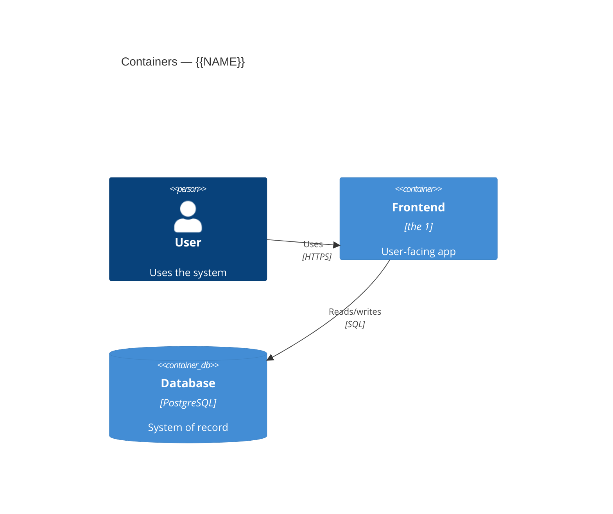

# 1-N-CQDS Scaffolding — Implementation Plan (Plan 2 of 5)

> **For agentic workers:** REQUIRED SUB-SKILL: Use superpowers:subagent-driven-development (recommended) or superpowers:executing-plans to implement this plan task-by-task. Steps use checkbox (`- [ ]`) syntax for tracking.

**Goal:** Build `scaffolding-repository` — the skill and the deterministic `scaffold.py` engine that turn a completed `ARCHITECTURE.md` + ADR set into a real repository skeleton: directory layout, Makefile, docker-compose (gate-approved components only), README with C4, VERSION.txt, CODEOWNERS, and a chosen LICENSE.

**Architecture:** An LLM-judgment + deterministic-template split, the same pattern Plan 1 proved. The `scaffolding-repository` skill reads `ARCHITECTURE.md` (fuzzy, LLM-appropriate) and invokes `scaffold.py` with explicit arguments (deterministic, testable). The script never parses prose — it takes structured flags and emits files. Templates live on disk under `assets/`; the script copies and variable-substitutes them.

**Tech Stack:** Python 3.11+ (scaffold engine, stdlib only — no deps), Make, Docker Compose v2 (Podman-compatible), mermaid (C4 in README), the five license texts.

## Where this sits

This is Plan 2 of 5. Plan 1 (the doctrine engine) is merged. The arc:

| Plan | Scope | Testable deliverable |
|---|---|---|
| 1 ✅ | Doctrine engine (router, purpose, architecture, ADRs) | Decisions + ADRs on an unseen project |
| **2 (this)** | Repo scaffolding — `scaffold.py` + templates | Run it → valid skeleton; `make up` boots infra (Postgres/MinIO) |
| 3 | Frontend — Astro, i18n, Playwright, Coolify preview | `frontend/` builds and renders; language switch works |
| 4 | Backends — Python/Go skeletons, multi-arch Dockerfiles, ORM/repository | `make up` boots the full stack; a service serves against Postgres |
| 5 | Delivery + releases — CI, registry, Trivy, GitFlow, backport | pipelines run; version bump tags |

**Why scaffolding is Plan 2:** frontend (Plan 3) and backends (Plan 4) both populate directories *inside* the skeleton this plan creates. It is the hard dependency, and it is independently valuable — the moment it works, a real 1-N-CQDS repo can be scaffolded from the Fieldnote decisions.

**Honest scope boundary:** a scaffolding-only skeleton references `frontend/Dockerfile` and `backends/{name}/Dockerfile` that don't exist until Plans 3–4. So Plan 2's `make up` boots only the **infra services the gates approved** (Postgres always; MinIO when object storage was chosen) — real images that run without custom code. The app services are stubbed in compose (commented, with a `# added in Plan 3/4` marker) so `docker-compose config` validates. Full-stack `up` is Plan 4's milestone. This boundary is a feature: it keeps Plan 2 testable today.

## Plan 1 learnings that govern this plan

These are hard-won; they are not optional.

1. **Point to the spec, don't reproduce it.** Four Plan-1 defects came from plan templates that drifted from the approved spec. *Doctrine text* in a skill must be copied verbatim from the spec and hash-verified. **Exception that applies heavily here:** template *assets* (Makefile, compose, licenses) ARE the deliverable, not doctrine — they live in files, are reviewed as code, and don't have a spec-verbatim source. The distinction: prose that states a rule → verbatim from spec; a Makefile → it's code, review it as code.
2. **Rationale vs. rules.** A skill may explain *why*; it may not invent doctrine the spec lacks. `scaffolding-repository` is largely a *technique* skill (how to scaffold), so most of it is procedure, not doctrine — but any architectural claim it makes must trace to the spec.
3. **Reference-and-record, not discipline.** Plan 1 found capable models already have good instincts; the value is artifacts + consistency. **Consequence for Plan 2:** this is deterministic tooling, not a discipline test. There are **no RED pressure baselines** here. `scaffold.py` gets ordinary TDD (given flags, assert emitted files). The skill is tested by *application* (run it, does a valid repo appear?), not by pressure scenarios.
4. **Rulings go to the spec first, then to skills.** Any decision that changes doctrine updates the spec before the skill. Task 1 does exactly this for two carried-over items.
5. **Grade on the artifact.** Plan 2's verdict is "does the scaffolded repo boot its infra and validate," not "did the skill sound right."

## Global Constraints

Copied verbatim from the spec (`docs/superpowers/specs/2026-07-17-1-n-cqds-design.md`), exact values:

- **Repo layout emitted:** `VERSION.txt`, `LICENSE`, `CODEOWNERS`, `README.md`, `ARCHITECTURE.md`, `Makefile`, `docker-compose.yml`, `docs/adr/`, `e2e/`, `frontend/`, `backends/{service}/`.
- **Makefile targets (mandatory):** `help`, `up`, `down`. Docker is default; `CONTAINER_ENGINE=podman` switches engine.
- **VERSION.txt** is the single source of truth. Format `MAJOR.MINOR.PATCH`. All components share one version.
- **docker-compose emits only gate-approved components.** "A diagram showing Redis when `docs/adr/` rejected Redis is a bug" — the same rule binds compose. Cache/queue appear only if their ADR accepted them.
- **Object storage** = S3-capable API: **MinIO in compose locally**, S3/R2/Spaces in prod.
- **Licenses shipped:** MIT, Apache-2.0, MPL-2.0, AGPL-3.0, BSL 1.1. **BSL 1.1 and any commercial arrangement ship with a mandatory disclaimer directing the user to a legal advisor.** The skill does not give legal advice.
- **README** explains repo structure + getting started, with a **C4 diagram (mermaid)**.
- **`scaffolding-repository` places `ARCHITECTURE.md`** (produced by `deciding-architecture`) at repo root and ensures the README links it. It does NOT re-author the C4 — single producer (ruling 2026-07-18).
- **Skill frontmatter:** `name` + `description` only. `description` starts with `Use when`, third person, triggers only (the router's imperative exception does NOT generalize).
- **scaffold.py:** stdlib only, no third-party deps. Python 3.11+.
- **Commit after every task.**

## File Structure

```
skills/scaffolding-repository/
├── SKILL.md                          # orchestrator: read ARCHITECTURE.md → build config → invoke scaffold.py → place ARCHITECTURE.md
├── scripts/
│   └── scaffold.py                   # deterministic engine: flags → emitted files (stdlib only)
├── assets/
│   ├── Makefile.tmpl                 # help/up/down, CONTAINER_ENGINE
│   ├── docker-compose.tmpl.yml       # gate-approved components only
│   ├── README.tmpl.md                # structure + getting started + C4
│   ├── gitignore.tmpl                # sensible defaults
│   ├── CODEOWNERS.tmpl
│   └── licenses/
│       ├── MIT.txt
│       ├── Apache-2.0.txt
│       ├── MPL-2.0.txt
│       ├── AGPL-3.0.txt
│       └── BSL-1.1.txt               # + commercial disclaimer
└── tests/
    └── test_scaffold.py              # pytest — given a config, assert emitted tree
```

Plus Task 1 edits to `docs/superpowers/specs/...` and `skills/defining-purpose/SKILL.md` and `skills/deciding-architecture/references/cache-queue-gate.md`.

**Config contract (the seam between skill and script).** `scaffold.py` takes a JSON config on stdin or `--config <path>`:

```json
{
  "name": "fieldnote",
  "version": "0.1.0",
  "license": "Apache-2.0",
  "language": "python",
  "frontend": "astro",
  "container_engine": "docker",
  "components": {"database": "postgres", "object_storage": "minio", "cache": null, "queue": null},
  "services": ["fieldnote"]
}
```

The skill builds this dict by reading `ARCHITECTURE.md`'s Stack table; the script only ever sees the dict. `components` values are the ACCEPTED choices; `null` means the gate rejected it and it must NOT appear in compose.

---

### Task 1: Carry-over spec refinements (primary user journey + queue-gate wording)

Two small Plan-1 follow-ups, done first because both are spec edits and the rule is "spec first." Neither is scaffolding, but both were recorded as forward dependencies and are cheap to close now.

**Files:**
- Modify: `docs/superpowers/specs/2026-07-17-1-n-cqds-design.md` (purpose fields; queue-gate wording)
- Modify: `skills/defining-purpose/SKILL.md` (add 6th field)
- Modify: `skills/deciding-architecture/references/cache-queue-gate.md` (tighten example)

**Interfaces:**
- Produces: `docs/purpose.md` now has a **Primary user journey** field, consumed by Plan 3's Playwright e2e (the spec names it a required e2e case).

- [ ] **Step 1: Add the field to the spec's purpose section**

In the spec's Frontend/Localization area where `docs/purpose.md`'s fields are implied, and in `defining-purpose`'s output list, the fields are currently: Vision, Users, Success, Non-goals, Stated constraints. Add a sixth. Edit the spec first — find the Playwright section's line "The primary user journey named in `docs/purpose.md`" and add, in the localization/frontend region, an explicit statement:

```markdown
`docs/purpose.md` includes a **Primary user journey** — the single most important end-to-end path a user takes (e.g. "record an observation offline → sync → generate the season PDF"). Plan 3 turns it into the mandatory Playwright e2e case.
```

- [ ] **Step 2: Add the field to defining-purpose**

In `skills/defining-purpose/SKILL.md`, the Output section lists five fields. Add:

```markdown
- **Primary user journey** — the one end-to-end path that matters most, in a sentence. It becomes the mandatory e2e test later. If you can't name one, the purpose isn't concrete enough yet.
```

- [ ] **Step 3: Tighten the queue-gate example**

The Fieldnote run showed the queue gate's "report generation" example could be mistaken for the *test*. In `skills/deciding-architecture/references/cache-queue-gate.md`, the queue-gate list item currently reads `work that must outlive a request (file processing, report generation)`. This text is spec-verbatim, so **edit the spec first**, then the skill, keeping them identical. Change both to:

```markdown
- work that must outlive a request — too large or slow to finish in-request (bulk file processing; a report too big to render within a request timeout)
```

This preserves the rule while making clear the example is gated by "too large or slow to finish in-request," not merely by being a report.

- [ ] **Step 4: Verify spec and skill agree**

Run: `diff <(grep -A2 "outlive a request" docs/superpowers/specs/2026-07-17-1-n-cqds-design.md) <(grep -A2 "outlive a request" skills/deciding-architecture/references/cache-queue-gate.md)`
Expected: the changed bullet matches between the two files (allowing for surrounding-context differences — the bullet line itself must be identical).

- [ ] **Step 5: Commit**

```bash
git add docs/superpowers/specs/ skills/defining-purpose/ skills/deciding-architecture/
git commit -m "spec: add primary-user-journey field; tighten queue-gate example wording"
```

---

### Task 2: scaffold.py core — config model and directory emission

**Files:**
- Create: `skills/scaffolding-repository/scripts/scaffold.py`
- Create: `skills/scaffolding-repository/tests/test_scaffold.py`

**Interfaces:**
- Consumes: a config dict (see Config contract above), via `--config <path>` or stdin.
- Produces: `scaffold(config: dict, dest: Path) -> list[Path]` — emits the base tree and returns the list of created paths. Later tasks add template rendering to the same function.

- [ ] **Step 1: Write the failing test**

```python
# skills/scaffolding-repository/tests/test_scaffold.py
import json, subprocess, sys
from pathlib import Path

SCRIPT = Path(__file__).parent.parent / "scripts" / "scaffold.py"

BASE_CONFIG = {
    "name": "fieldnote", "version": "0.1.0", "license": "Apache-2.0",
    "language": "python", "frontend": "astro", "container_engine": "docker",
    "components": {"database": "postgres", "object_storage": "minio", "cache": None, "queue": None},
    "services": ["fieldnote"],
}

def run_scaffold(tmp_path, config):
    cfg = tmp_path / "cfg.json"
    cfg.write_text(json.dumps(config))
    r = subprocess.run([sys.executable, str(SCRIPT), "--config", str(cfg), "--dest", str(tmp_path / "out")],
                       capture_output=True, text=True)
    assert r.returncode == 0, r.stderr
    return tmp_path / "out"

def test_emits_base_directory_layout(tmp_path):
    out = run_scaffold(tmp_path, BASE_CONFIG)
    for p in ["VERSION.txt", "docs/adr", "e2e", "frontend", "backends/fieldnote"]:
        assert (out / p).exists(), f"missing {p}"

def test_version_txt_is_single_source(tmp_path):
    out = run_scaffold(tmp_path, BASE_CONFIG)
    assert (out / "VERSION.txt").read_text().strip() == "0.1.0"
```

- [ ] **Step 2: Run it, verify it fails**

Run: `cd skills/scaffolding-repository && python -m pytest tests/test_scaffold.py -v`
Expected: FAIL — `scaffold.py` does not exist / no such file.

- [ ] **Step 3: Write the minimal engine**

```python
#!/usr/bin/env python3
"""scaffold.py — deterministic 1-N-CQDS repository emitter.

Takes a structured config (never prose) and writes a repository skeleton.
stdlib only. The scaffolding-repository skill builds the config by reading
ARCHITECTURE.md; this script only ever sees the config.
"""
import argparse, json, sys
from pathlib import Path

def load_config(args) -> dict:
    if args.config:
        return json.loads(Path(args.config).read_text())
    return json.loads(sys.stdin.read())

def scaffold(config: dict, dest: Path) -> list[Path]:
    created = []
    def mkdir(rel):
        p = dest / rel; p.mkdir(parents=True, exist_ok=True); created.append(p)
    def write(rel, content):
        p = dest / rel; p.parent.mkdir(parents=True, exist_ok=True)
        p.write_text(content); created.append(p)

    mkdir("docs/adr")
    mkdir("e2e")
    mkdir("frontend")
    for svc in config["services"]:
        mkdir(f"backends/{svc}")
    write("VERSION.txt", config["version"] + "\n")
    return created

def main():
    ap = argparse.ArgumentParser()
    ap.add_argument("--config"); ap.add_argument("--dest", required=True)
    args = ap.parse_args()
    config = load_config(args)
    dest = Path(args.dest); dest.mkdir(parents=True, exist_ok=True)
    created = scaffold(config, dest)
    print(f"scaffolded {len(created)} paths into {dest}")

if __name__ == "__main__":
    main()
```

- [ ] **Step 4: Run tests, verify pass**

Run: `cd skills/scaffolding-repository && python -m pytest tests/test_scaffold.py -v`
Expected: 2 passed.

- [ ] **Step 5: Commit**

```bash
git add skills/scaffolding-repository/scripts/scaffold.py skills/scaffolding-repository/tests/test_scaffold.py
git commit -m "feat: scaffold.py core — config model and base directory emission"
```

---

### Task 3: Makefile template + rendering

**Files:**
- Create: `skills/scaffolding-repository/assets/Makefile.tmpl`
- Modify: `skills/scaffolding-repository/scripts/scaffold.py` (render Makefile)
- Modify: `skills/scaffolding-repository/tests/test_scaffold.py` (assert Makefile)

**Interfaces:**
- Consumes: `config["container_engine"]`.
- Produces: `Makefile` at repo root with `help`, `up`, `down` targets; docker default, `CONTAINER_ENGINE=podman` override.

- [ ] **Step 1: Write the failing test**

```python
def test_makefile_has_mandatory_targets(tmp_path):
    out = run_scaffold(tmp_path, BASE_CONFIG)
    mk = (out / "Makefile").read_text()
    for target in ["help:", "up:", "down:"]:
        assert target in mk, f"missing target {target}"
    # docker is default, podman overridable
    assert "CONTAINER_ENGINE ?= docker" in mk

def test_makefile_help_runs(tmp_path):
    out = run_scaffold(tmp_path, BASE_CONFIG)
    import subprocess
    r = subprocess.run(["make", "-C", str(out), "help"], capture_output=True, text=True)
    assert r.returncode == 0, r.stderr
    assert "up" in r.stdout and "down" in r.stdout
```

- [ ] **Step 2: Run, verify fail**

Run: `cd skills/scaffolding-repository && python -m pytest tests/test_scaffold.py::test_makefile_has_mandatory_targets -v`
Expected: FAIL — no Makefile emitted.

- [ ] **Step 3: Write the template**

```makefile
# skills/scaffolding-repository/assets/Makefile.tmpl
# {{NAME}} — local development stack.
# Container engine defaults to docker; override with: make up CONTAINER_ENGINE=podman
CONTAINER_ENGINE ?= docker
COMPOSE = $(CONTAINER_ENGINE) compose

.DEFAULT_GOAL := help

.PHONY: help up down
help: ## Show this help
	@grep -E '^[a-zA-Z_-]+:.*?## .*$$' $(MAKEFILE_LIST) | \
	  awk 'BEGIN {FS = ":.*?## "}; {printf "  \033[36m%-12s\033[0m %s\n", $$1, $$2}'

up: ## Bring up the local stack
	$(COMPOSE) up -d --build

down: ## Tear down the local stack
	$(COMPOSE) down
```

- [ ] **Step 4: Render it from scaffold.py**

Add to `scaffold.py` — a template helper and a call in `scaffold()`:

```python
ASSETS = Path(__file__).parent.parent / "assets"

def render(template_name: str, mapping: dict) -> str:
    text = (ASSETS / template_name).read_text()
    for k, v in mapping.items():
        text = text.replace("{{" + k + "}}", str(v))
    return text

# inside scaffold(), before returning:
    write("Makefile", render("Makefile.tmpl", {"NAME": config["name"]}))
```

- [ ] **Step 5: Run tests, verify pass**

Run: `cd skills/scaffolding-repository && python -m pytest tests/test_scaffold.py -v`
Expected: all pass (including `make help` actually running).

- [ ] **Step 6: Commit**

```bash
git add skills/scaffolding-repository/
git commit -m "feat: Makefile template with help/up/down and engine override"
```

---

### Task 4: docker-compose template — gate-approved components only

**Files:**
- Create: `skills/scaffolding-repository/assets/docker-compose.tmpl.yml`
- Modify: `skills/scaffolding-repository/scripts/scaffold.py` (render compose from components)
- Modify: `skills/scaffolding-repository/tests/test_scaffold.py`

**Interfaces:**
- Consumes: `config["components"]` — `database`, `object_storage`, `cache`, `queue` (any may be `null`).
- Produces: `docker-compose.yml` containing services for **only** the non-null approved components, plus commented app-service stubs.

- [ ] **Step 1: Write the failing tests — the doctrine-critical ones**

```python
import subprocess

def test_compose_includes_approved_components(tmp_path):
    out = run_scaffold(tmp_path, BASE_CONFIG)  # postgres + minio approved
    compose = (out / "docker-compose.yml").read_text()
    assert "postgres" in compose
    assert "minio" in compose

def test_compose_omits_rejected_components(tmp_path):
    # cache and queue are null (rejected) in BASE_CONFIG
    out = run_scaffold(tmp_path, BASE_CONFIG)
    compose = (out / "docker-compose.yml").read_text().lower()
    assert "redis" not in compose, "rejected cache must not appear"
    assert "rabbitmq" not in compose and "amqp" not in compose, "rejected queue must not appear"

def test_compose_includes_cache_when_approved(tmp_path):
    cfg = dict(BASE_CONFIG); cfg["components"] = dict(BASE_CONFIG["components"], cache="redis")
    out = run_scaffold(tmp_path, cfg)
    assert "redis" in (out / "docker-compose.yml").read_text().lower()

def test_compose_config_validates(tmp_path):
    out = run_scaffold(tmp_path, BASE_CONFIG)
    # docker or podman may be absent in CI; skip the runtime check gracefully
    import shutil
    engine = "docker" if shutil.which("docker") else ("podman" if shutil.which("podman") else None)
    if not engine:
        import pytest; pytest.skip("no container engine available")
    r = subprocess.run([engine, "compose", "-f", str(out / "docker-compose.yml"), "config"],
                       capture_output=True, text=True)
    assert r.returncode == 0, r.stderr
```

- [ ] **Step 2: Run, verify fail**

Run: `cd skills/scaffolding-repository && python -m pytest tests/test_scaffold.py -k compose -v`
Expected: FAIL — no compose emitted.

- [ ] **Step 3: Write the compose template**

A compose file assembled from parts. Put the full template in the asset with all optional blocks, and have `scaffold.py` select. Simplest robust approach: the template is a Python-side assembly, not a single static file with conditionals (YAML has no conditionals). So the asset holds named fragments and the script concatenates. Write the asset as fragments separated by markers:

```yaml
# skills/scaffolding-repository/assets/docker-compose.tmpl.yml
# --- HEADER ---
# {{NAME}} local stack. Managed by 1-N-CQDS scaffolding.
# App services (frontend, backends) are added in Plans 3-4; stubbed below.
services:
# --- DATABASE:postgres ---
  db:
    image: postgres:16.4-alpine
    environment:
      POSTGRES_USER: {{NAME}}
      POSTGRES_PASSWORD: devpassword
      POSTGRES_DB: {{NAME}}
    ports: ["5432:5432"]
    volumes: ["db_data:/var/lib/postgresql/data"]
    healthcheck:
      test: ["CMD-SHELL", "pg_isready -U {{NAME}}"]
      interval: 5s
      timeout: 5s
      retries: 5
# --- OBJECT_STORAGE:minio ---
  objectstore:
    image: minio/minio:RELEASE.2024-08-17T01-24-54Z
    command: server /data --console-address ":9001"
    environment:
      MINIO_ROOT_USER: {{NAME}}
      MINIO_ROOT_PASSWORD: devpassword
    ports: ["9000:9000", "9001:9001"]
    volumes: ["objectstore_data:/data"]
# --- CACHE:redis ---
  cache:
    image: redis:7.4-alpine
    ports: ["6379:6379"]
# --- QUEUE:rabbitmq ---
  queue:
    image: rabbitmq:3.13-management-alpine
    ports: ["5672:5672", "15672:15672"]
# --- APPSTUB ---
# Added in Plan 3 (frontend) and Plan 4 (backends):
#   frontend:
#     build: ./frontend
#   {{NAME}}:
#     build: ./backends/{{NAME}}
# --- VOLUMES ---
volumes:
# --- VOL:db ---
  db_data:
# --- VOL:obj ---
  objectstore_data:
```

- [ ] **Step 4: Assemble in scaffold.py**

```python
def render_compose(config: dict) -> str:
    raw = (ASSETS / "docker-compose.tmpl.yml").read_text()
    frags = {}
    cur = None
    for line in raw.splitlines():
        if line.startswith("# --- ") and line.endswith(" ---"):
            cur = line[6:-4]; frags[cur] = []
        elif cur is not None:
            frags[cur].append(line)
    def block(name): return "\n".join(frags.get(name, []))
    comp = config["components"]
    out = [block("HEADER")]
    if comp.get("database") == "postgres": out.append(block("DATABASE:postgres"))
    if comp.get("object_storage") == "minio": out.append(block("OBJECT_STORAGE:minio"))
    if comp.get("cache") == "redis": out.append(block("CACHE:redis"))
    if comp.get("queue") == "rabbitmq": out.append(block("QUEUE:rabbitmq"))
    out.append(block("APPSTUB"))
    out.append(block("VOLUMES"))
    if comp.get("database") == "postgres": out.append(block("VOL:db"))
    if comp.get("object_storage") == "minio": out.append(block("VOL:obj"))
    text = "\n".join(out)
    for k, v in {"NAME": config["name"]}.items():
        text = text.replace("{{" + k + "}}", str(v))
    return text

# in scaffold():
    write("docker-compose.yml", render_compose(config))
```

- [ ] **Step 5: Run tests, verify pass**

Run: `cd skills/scaffolding-repository && python -m pytest tests/test_scaffold.py -k compose -v`
Expected: pass (the `config` validation test skips if no engine present — that is correct, not a failure).

- [ ] **Step 6: Commit**

```bash
git add skills/scaffolding-repository/
git commit -m "feat: docker-compose emits only gate-approved components"
```

---

### Task 5: README template with C4, VERSION, gitignore, CODEOWNERS

**Files:**
- Create: `skills/scaffolding-repository/assets/README.tmpl.md`
- Create: `skills/scaffolding-repository/assets/gitignore.tmpl`
- Create: `skills/scaffolding-repository/assets/CODEOWNERS.tmpl`
- Modify: `scaffold.py`, `test_scaffold.py`

**Interfaces:**
- Consumes: `config["name"]`, `config["services"]`, `config["components"]`.
- Produces: `README.md` (structure + getting started + C4 mermaid, links `ARCHITECTURE.md`), `.gitignore`, `CODEOWNERS`.

- [ ] **Step 1: Write the failing test**

```python
def test_readme_has_c4_and_links_architecture(tmp_path):
    out = run_scaffold(tmp_path, BASE_CONFIG)
    readme = (out / "README.md").read_text()
    assert "```mermaid" in readme
    assert "C4Context" in readme
    assert "ARCHITECTURE.md" in readme  # must link the decision record
    assert "make up" in readme          # getting started

def test_codeowners_and_gitignore_emitted(tmp_path):
    out = run_scaffold(tmp_path, BASE_CONFIG)
    assert (out / ".gitignore").exists()
    assert (out / "CODEOWNERS").exists()
```

- [ ] **Step 2: Run, verify fail**

Run: `cd skills/scaffolding-repository && python -m pytest tests/test_scaffold.py -k "readme or codeowners" -v`
Expected: FAIL.

- [ ] **Step 3: Write the README template**

```markdown
<!-- skills/scaffolding-repository/assets/README.tmpl.md -->
# {{NAME}}

A 1-N-CQDS repository: **1** frontend, **N** backend services, plus the
Cache / Queue / Database / Storage components the architecture actually needs.

Architecture decisions live in [`ARCHITECTURE.md`](./ARCHITECTURE.md) and
[`docs/adr/`](./docs/adr/). Components absent here were **deliberately rejected** —
read the ADR before adding one.

## Structure

```
frontend/            the 1 — user-facing app
backends/            the N — stateless services
e2e/                 Playwright end-to-end tests (the whole stack)
docs/adr/            architecture decision records
ARCHITECTURE.md      synthesis + C4 diagrams
VERSION.txt          single source of truth for version
docker-compose.yml   local stack (gate-approved components only)
Makefile             help / up / down
```

## Getting started

```bash
make up      # bring up the local stack (docker; or: make up CONTAINER_ENGINE=podman)
make down    # tear it down
make help    # list targets
```

## Architecture (C4 — Container)



See [`ARCHITECTURE.md`](./ARCHITECTURE.md) for the full Context + Container diagrams.
```

- [ ] **Step 4: Write gitignore and CODEOWNERS templates**

```
# skills/scaffolding-repository/assets/gitignore.tmpl
__pycache__/
*.pyc
node_modules/
dist/
.env
*.local
.DS_Store
```

```
# skills/scaffolding-repository/assets/CODEOWNERS.tmpl
# Every merge needs an owner's review. Replace with real teams/handles.
* @{{NAME}}-maintainers
/frontend/ @{{NAME}}-frontend
/backends/ @{{NAME}}-backend
```

- [ ] **Step 5: Render all three in scaffold.py**

```python
    write("README.md", render("README.tmpl.md", {"NAME": config["name"]}))
    write(".gitignore", render("gitignore.tmpl", {}))
    write("CODEOWNERS", render("CODEOWNERS.tmpl", {"NAME": config["name"]}))
```

- [ ] **Step 6: Verify the README C4 renders**

Run: `cd skills/scaffolding-repository && python -c "from tests.test_scaffold import *; import tempfile,pathlib; d=pathlib.Path(tempfile.mkdtemp()); run_scaffold(d, BASE_CONFIG)" && npx -y @mermaid-js/mermaid-cli -i /tmp/<the-out>/README.md -o /tmp/readme.svg 2>&1 | tail -2`
Simpler: extract the mermaid block from a scaffolded README and render it. Expected: SVG written, no parse error. If `mermaid-cli` is unavailable, paste the block into the Mermaid live editor; record which method was used.

- [ ] **Step 7: Run tests, commit**

Run: `cd skills/scaffolding-repository && python -m pytest tests/test_scaffold.py -v`
Expected: all pass.

```bash
git add skills/scaffolding-repository/
git commit -m "feat: README with C4, plus gitignore and CODEOWNERS templates"
```

---

### Task 6: License templates + selection + commercial disclaimer

**Files:**
- Create: `skills/scaffolding-repository/assets/licenses/{MIT,Apache-2.0,MPL-2.0,AGPL-3.0,BSL-1.1}.txt`
- Modify: `scaffold.py`, `test_scaffold.py`

**Interfaces:**
- Consumes: `config["license"]` — one of the five slugs.
- Produces: `LICENSE` with the chosen text; for BSL-1.1, a mandatory `**Seek legal advice**` disclaimer block.

- [ ] **Step 1: Write the failing tests**

```python
import pytest

@pytest.mark.parametrize("slug,marker", [
    ("MIT", "Permission is hereby granted"),
    ("Apache-2.0", "Apache License"),
    ("MPL-2.0", "Mozilla Public License"),
    ("AGPL-3.0", "GNU AFFERO GENERAL PUBLIC LICENSE"),
    ("BSL-1.1", "Business Source License"),
])
def test_license_emitted(tmp_path, slug, marker):
    cfg = dict(BASE_CONFIG, license=slug)
    out = run_scaffold(tmp_path, cfg)
    assert marker in (out / "LICENSE").read_text()

def test_bsl_carries_legal_disclaimer(tmp_path):
    out = run_scaffold(tmp_path, dict(BASE_CONFIG, license="BSL-1.1"))
    text = (out / "LICENSE").read_text().lower()
    assert "legal" in text and "advis" in text, "BSL must direct the user to a legal advisor"

def test_unknown_license_errors(tmp_path):
    import json, subprocess, sys
    cfg = tmp_path / "c.json"; cfg.write_text(json.dumps(dict(BASE_CONFIG, license="WTFPL")))
    r = subprocess.run([sys.executable, str(SCRIPT), "--config", str(cfg), "--dest", str(tmp_path/"o")],
                       capture_output=True, text=True)
    assert r.returncode != 0, "unknown license must fail loudly, not silently emit nothing"
```

- [ ] **Step 2: Run, verify fail**

Run: `cd skills/scaffolding-repository && python -m pytest tests/test_scaffold.py -k license -v`
Expected: FAIL.

- [ ] **Step 3: Add the five license texts**

Fetch the canonical text for each into `assets/licenses/<slug>.txt`. Use the official SPDX text. For `BSL-1.1.txt`, append after the license body:

```
---

## Commercial licensing — IMPORTANT

The Business Source License is source-available, not OSI-approved open source.
If you intend to use, sell, or distribute this software commercially, or to
choose or modify the Additional Use Grant / Change Date above, **consult a
qualified legal advisor.** 1-N-CQDS and this scaffold do not provide legal
advice, and nothing here is a substitute for it.
```

(Implementer: retrieve each license's exact SPDX text at build time — do not hand-transcribe; a paraphrased license is legally meaningless. If offline, note it and stub with the SPDX identifier + a fetch instruction, failing the task rather than shipping fake text.)

- [ ] **Step 4: Render + validate in scaffold.py**

```python
VALID_LICENSES = {"MIT", "Apache-2.0", "MPL-2.0", "AGPL-3.0", "BSL-1.1"}

# early in scaffold(), before writing files:
    lic = config["license"]
    if lic not in VALID_LICENSES:
        raise SystemExit(f"unknown license '{lic}'; choose one of {sorted(VALID_LICENSES)}")
# where files are written:
    write("LICENSE", (ASSETS / "licenses" / f"{lic}.txt").read_text())
```

- [ ] **Step 5: Run tests, verify pass; commit**

Run: `cd skills/scaffolding-repository && python -m pytest tests/test_scaffold.py -v`
Expected: all pass.

```bash
git add skills/scaffolding-repository/
git commit -m "feat: five license templates with mandatory BSL legal disclaimer"
```

---

### Task 7: scaffolding-repository SKILL.md — the orchestrator

**Files:**
- Create: `skills/scaffolding-repository/SKILL.md`

**Interfaces:**
- Consumes: a repo with `ARCHITECTURE.md` present (produced by `deciding-architecture`).
- Produces: the scaffolded repo — by reading the Stack table, building the config dict, invoking `scaffold.py`, then placing `ARCHITECTURE.md` at root and confirming the README links it.

- [ ] **Step 1: Write the skill**

A *technique* skill (procedure, not doctrine). `description` compliant (no router exception). Budget <500 words.

```markdown
---
name: scaffolding-repository
description: Use when a project's ARCHITECTURE.md and ADRs are complete and it needs its repository structure created — directory layout, Makefile, docker-compose, README, license, and version file
---

# Scaffolding a Repository

Turns a completed architecture into a real repo skeleton. The decisions are
already made and recorded in `ARCHITECTURE.md`; this step lays out the files.

**REQUIRED BACKGROUND:** Use 1-n-cqds for the four invariants.
**Prerequisite:** `ARCHITECTURE.md` must exist. If it doesn't — **REQUIRED
SUB-SKILL:** Use deciding-architecture first. Do not scaffold undecided architecture.

## The split: you read, the script emits

You do the fuzzy reading; `scripts/scaffold.py` does the deterministic emission.
Never hand-write the repo files — the script owns them, so a fix lands once for
every future project.

## Steps

1. **Read `ARCHITECTURE.md`'s Stack table.** Extract: system name, version
   (from `VERSION.txt` if present, else `0.1.0`), language, frontend framework,
   and each CQDS component's accepted value. **A component the ADRs rejected is
   `null` — it must not enter the config.** This is invariant 4 at the repo
   level: a rejected component in compose is a bug.

2. **Build the config dict** (see `scripts/scaffold.py --help`):

   ```json
   {"name": "...", "version": "...", "license": "...", "language": "...",
    "frontend": "...", "container_engine": "docker",
    "components": {"database": "...", "object_storage": "...|null",
                   "cache": "...|null", "queue": "...|null"},
    "services": ["..."]}
   ```

3. **Confirm the license with the user** if `ARCHITECTURE.md` didn't record one.
   Open source is preferred; for a commercial/BSL choice, state plainly that they
   should consult a legal advisor — you do not give legal advice.

4. **Invoke the script:**
   `python scripts/scaffold.py --config <cfg.json> --dest <repo-root>`

5. **Place `ARCHITECTURE.md`** at the repo root (it's the decision record and the
   evolve-mode switch) and confirm the generated `README.md` links it. Do not
   re-author the C4 — `deciding-architecture` already produced it.

6. **Report** what was emitted and what was deliberately omitted (the rejected
   components), pointing at the ADRs.

## What this skill does not do

Frontend code (Plan 3), backend services (Plan 4), and CI/release wiring
(Plan 5) are separate. This produces the skeleton they populate. `make up` here
boots the infra (database, object storage); app services join later.
```

- [ ] **Step 2: Verify word budget and description compliance**

Run: `wc -w skills/scaffolding-repository/SKILL.md`
Expected: <500. Confirm `description` starts with "Use when", third person, no other-plugin skill names.

- [ ] **Step 3: Commit**

```bash
git add skills/scaffolding-repository/SKILL.md
git commit -m "feat: scaffolding-repository orchestrator skill"
```

---

### Task 8: End-to-end scaffold validation — the Plan 2 verdict

**Files:**
- Create: `tests/scenarios/e2e-scaffold.md`
- Create: `tests/scenarios/baseline-results/e2e-scaffold-results.md`

**Interfaces:**
- Consumes: everything.
- Produces: the go/no-go on Plan 2. This is the walking-skeleton verification — scaffold the Fieldnote repo from its real `ARCHITECTURE.md` and confirm a valid, infra-bootable skeleton.

- [ ] **Step 1: Reconstruct the Fieldnote decisions as input**

The Fieldnote `ARCHITECTURE.md` was produced in Plan 1's end-to-end (preserved at `/tmp/fieldnote-output.bundle`, or regenerate). Its Stack table yields:

```json
{"name": "fieldnote", "version": "0.1.0", "license": "Apache-2.0",
 "language": "python", "frontend": "astro", "container_engine": "docker",
 "components": {"database": "postgres", "object_storage": "minio", "cache": null, "queue": null},
 "services": ["fieldnote"]}
```

Note the doctrine-critical expectation: Fieldnote **rejected cache and queue**. The scaffolded compose must contain Postgres and MinIO and **must NOT contain Redis or RabbitMQ.**

- [ ] **Step 2: Scaffold into a scratch dir**

Run: `python skills/scaffolding-repository/scripts/scaffold.py --config /tmp/fieldnote-cfg.json --dest /tmp/fieldnote-repo`
Expected: exits 0, reports paths created.

- [ ] **Step 3: Grade the emitted skeleton**

| Check | Expected | How |
|---|---|---|
| Layout | frontend/, backends/fieldnote/, e2e/, docs/adr/ | `ls` |
| VERSION.txt | `0.1.0` | `cat` |
| Makefile | help/up/down present, `make help` runs | `make -C /tmp/fieldnote-repo help` |
| compose | postgres + minio present; **no redis, no rabbitmq** | grep |
| compose validity | `docker compose config` exits 0 (skip if no engine) | run |
| README | C4 renders, links ARCHITECTURE.md | mermaid-cli |
| LICENSE | Apache-2.0 text | grep |
| CODEOWNERS | present | `ls` |

- [ ] **Step 4: Boot the infra (the real walking-skeleton test)**

If a container engine is available:

Run: `make -C /tmp/fieldnote-repo up` then `docker compose -f /tmp/fieldnote-repo/docker-compose.yml ps`
Expected: `db` (Postgres) reaches healthy; `objectstore` (MinIO) is up. Then `make -C /tmp/fieldnote-repo down`.

**If no engine is available in this environment, say so explicitly** and mark this step "verified by `compose config` only, runtime boot not exercised here." Do not claim a boot that didn't happen — the Plan 1 discipline on honest verification holds.

- [ ] **Step 5: Record results**

Write `tests/scenarios/baseline-results/e2e-scaffold-results.md`: the config used, every graded row (pass/fail), the compose contents (proving no rejected components), whether infra booted or was config-validated only, and any divergence.

- [ ] **Step 6: Commit and report the verdict**

```bash
git add tests/scenarios/
git commit -m "test: end-to-end scaffold validation on Fieldnote"
```

Present to Greg: the emitted skeleton, the compose proving cache/queue absent, the boot (or config-validate) result. **Plan 2 is done when scaffolding the Fieldnote decisions yields a valid skeleton whose compose contains exactly the approved components and whose infra boots (or validates).** That verdict is Greg's.

---

## Self-Review

**Spec coverage** — every Plan-2 spec item traces to a task:

| Spec item | Task |
|---|---|
| Repo layout (frontend/backends/e2e/docs/adr/VERSION) | 2 |
| Makefile help/up/down + podman | 3 |
| docker-compose, approved components only | 4 |
| MinIO for object storage locally | 4 |
| README + C4 mermaid | 5 |
| VERSION.txt SSOT | 2 |
| CODEOWNERS | 5 |
| Five licenses + BSL legal disclaimer | 6 |
| scaffolding-repository reads ARCHITECTURE.md, places it | 7 |
| Primary-user-journey field (forward dep) | 1 |
| Queue-gate wording tighten (forward dep) | 1 |
| End-to-end validation | 8 |

Deferred by design: Dockerfiles (Plans 3/4, live with their components), frontend/Astro/i18n/Playwright (Plan 3), backend skeletons/ORM (Plan 4), CI/registry/Trivy/GitFlow/backport (Plan 5).

**Placeholder scan:** the only external dependency is the license texts (Task 6), which must be fetched (canonical SPDX), not transcribed — the task says so and says to fail rather than ship fake text.

**Type consistency:** the config dict shape is identical in the Config contract, Task 2's test, and Task 7's skill. `scaffold(config, dest) -> list[Path]`, `render(template_name, mapping)`, `render_compose(config)` are consistent across Tasks 2–6. `components` values are the accepted choice or `null` throughout.

**Known verification limit:** whether `make up` truly boots infra depends on a container engine being present in the execution environment. Task 8 Step 4 handles both cases explicitly and forbids claiming an unrun boot — consistent with Plan 1's honest-verification discipline.
