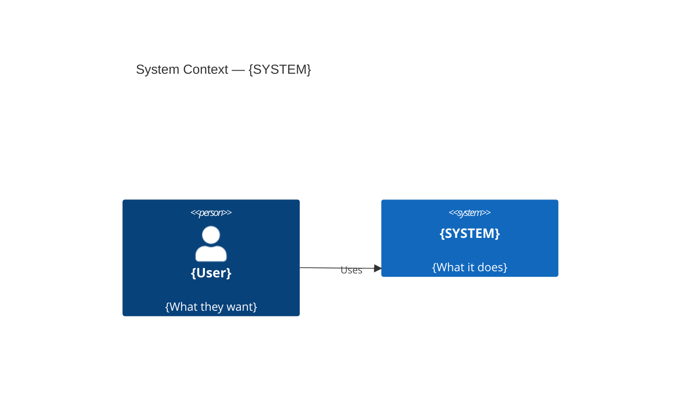
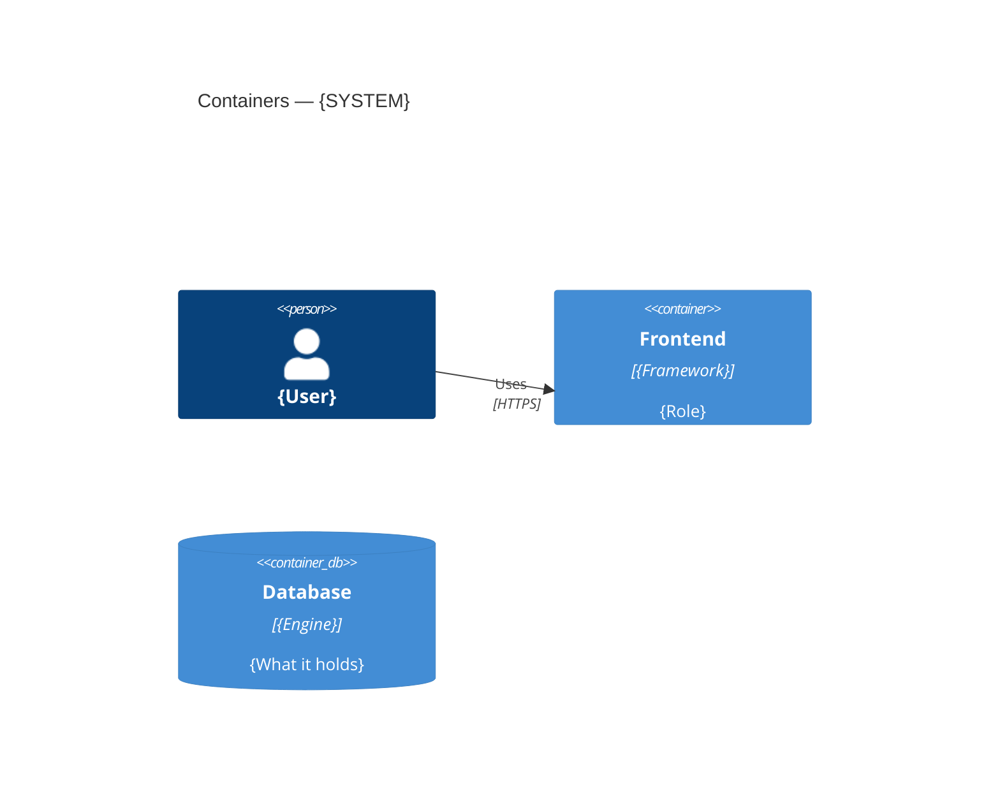

# Architecture

**Version:** {VERSION}
**Last reviewed:** {YYYY-MM-DD}

## Purpose

{One paragraph from docs/purpose.md.}

## State inventory

| State | Shape | Lifetime | Size | Destination | ADR |
|---|---|---|---|---|---|

<!-- The Size column carries Step 1's "size estimate" field. Data volume is a
     decision input the gates consume: MariaDB-vs-Postgres (horizontal scale),
     the cache gate (expensive to compute), blob-vs-DB on the storage ladder.
     Step 1 collects it; this table records it. Do not drop one without the other. -->

## Stack

| Concern | Choice | ADR |
|---|---|---|
| Language | | |
| Database | | |
| Portability layer | | |
| Object storage | | |
| Cache | | |
| Queue | | |

Components marked **None** are deliberate rejections, not omissions. Follow
the ADR before proposing one.

## C4 — Context

## C4 — Container

Include only containers the gates approved. A diagram showing Redis when
`docs/adr/` rejected Redis is a bug.

## Decision log

| ADR | Decision |
|---|---|
