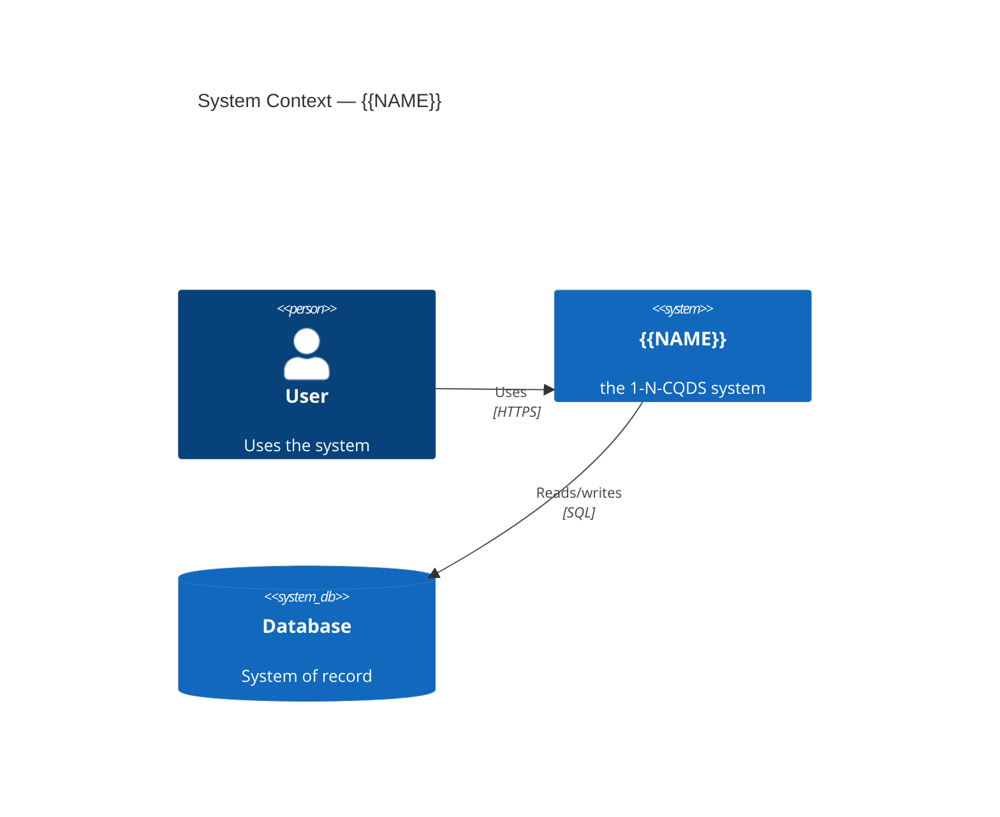

# {{NAME}}

A 1-N-CQDS repository: **1** frontend, **N** backend services, plus the
Cache / Queue / Database / Storage components the architecture actually needs.

Architecture decisions live in [`ARCHITECTURE.md`](./ARCHITECTURE.md) and
[`docs/adr/`](./docs/adr/). Components absent here were **deliberately rejected** —
read the ADR before adding one.

## Structure

```
frontend/            the 1 — user-facing app
backends/            the N — stateless services
e2e/                 Playwright end-to-end tests (the whole stack)
docs/adr/            architecture decision records
ARCHITECTURE.md      synthesis + C4 diagrams
VERSION.txt          single source of truth for version
docker-compose.yml   local stack (gate-approved components only)
Makefile             help / up / down
```

## Getting started

```bash
make up      # bring up the local stack (docker; or: make up CONTAINER_ENGINE=podman)
make down    # tear it down
make help    # list targets
```

## Architecture (C4 — Context)

Illustrative only — this diagram is a fixed placeholder and does not
reflect which components this repository's architecture actually approved
(a stateless service, for example, may have no database at all). For the
diagram synthesized from the real, gate-approved decisions, see
[`ARCHITECTURE.md`](./ARCHITECTURE.md).



See [`ARCHITECTURE.md`](./ARCHITECTURE.md) for the full Context + Container diagrams.
